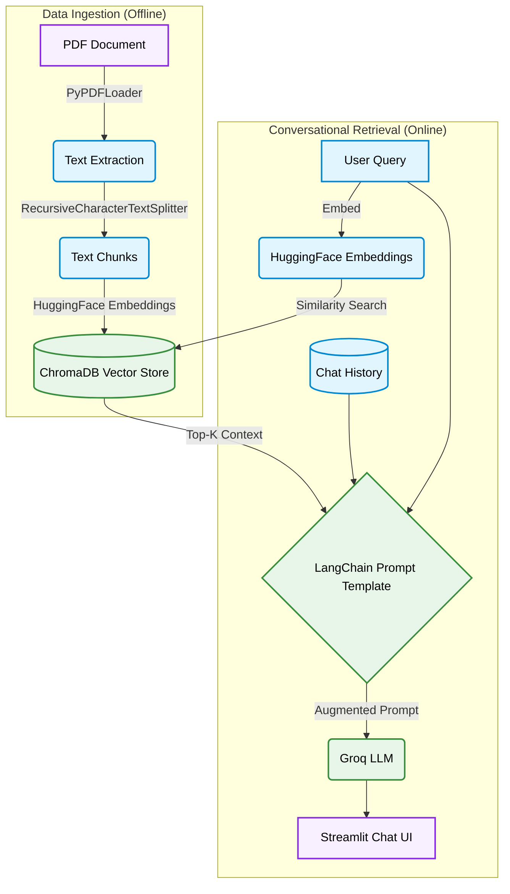

# Conversational RAG Chatbot

A Retrieval-Augmented Generation web application that lets you chat with your PDFs with conversational memory.

> **Live Deployments:**
> * **Interactive Streamlit App:** [conversational-rag-chatbot-pdf.streamlit.app](https://conversational-rag-chatbot-pdf.streamlit.app/)

---

## Overview

Conversational RAG Chatbot turns dense, static PDF documents into interactive conversational partners. Leveraging LangChain orchestration, Hugging Face embeddings, ChromaDB vector indexing, and Groq LLM inference, the system reformulates user questions based on conversation history and retrieves semantically relevant context chunks to answer inquiries accurately without hallucinations.

---

## Architecture Overview



```
PDF Upload
   │
   ▼
PyPDFLoader ──► RecursiveCharacterTextSplitter
   │
   ▼
HuggingFace Embeddings (all-MiniLM-L6-v2)
   │
   ▼
ChromaDB Vector Store
   │
   ├──────────────┬──────────────┐
   │              │              │
Retriever   Chat History         │
   │              │              │
   └──────┬───────┘              │
          ▼                      │
History-Aware Retriever (LangChain)
          │
          ▼
Groq LLM (openai/gpt-oss-20b)
          │
          ▼
     Final Grounded Answer
```

---

## Features

| Feature | Description |
| ------- | ----------- |
| **Multi-PDF Upload** | Ingest and search across single or multiple PDF documents simultaneously |
| **Conversational Memory** | Preserves context across multi-turn dialogues by reformulating ambiguous follow-ups |
| **Local Embedding Pipeline** | Uses Hugging Face `all-MiniLM-L6-v2` embeddings for private vector representations |
| **ChromaDB Indexing** | Fast, local vector store management with similarity search scoring |
| **Sub-Second LLM Inference** | High-throughput generation powered by Groq cloud endpoints |
| **Session Isolation** | Clean per-session chat history separation inside Streamlit |

---

## Technology Stack

| Component | Technology |
| --------- | ---------- |
| Frontend UI | Streamlit |
| LLM Provider | Groq API |
| Embedding Model | Hugging Face (`sentence-transformers/all-MiniLM-L6-v2`) |
| Vector Store | ChromaDB |
| Orchestration Framework | LangChain |
| PDF Extraction | PyPDFLoader / pypdf |
| Testing & Linting | pytest, ruff |

---

## Project Structure

```
Conversational-RAG-Chatbot/
├── app.py              # Streamlit frontend and session management
├── rag_core.py         # RAG pipeline: document chunking, indexing, and history-aware chains
├── tests/
│   ├── conftest.py     # Test fixtures and mock setups
│   └── test_rag_core.py# Unit tests for text splitting and retrieval logic
├── Dockerfile          # Container build definition
├── requirements.txt    # Production dependencies
└── README.md
```

---

## Setup and Installation

### Prerequisites

- Python 3.10+
- A [Groq API key](https://console.groq.com/keys)

### 1. Clone the repository

```bash
git clone https://github.com/Shashank17singh/Conversational-RAG-Chatbot.git
cd Conversational-RAG-Chatbot
```

### 2. Install dependencies

```bash
pip install -r requirements.txt
```

### 3. Configure environment variables

```bash
cp .env.example .env
# Edit .env and supply your credentials:
# GROQ_API_KEY=your_api_key_here
```

### 4. Run the application

```bash
streamlit run app.py
```

---

## Running the Tests

Run the test suite using pytest:

```bash
pytest
```

Run static code analysis and linting:

```bash
ruff check .
```

---

## Deployment

The application is containerized and deployable to any Docker host or cloud container runtime:

```bash
docker build -t conversational-rag-chatbot .
docker run -p 8501:8501 -e GROQ_API_KEY=your_key conversational-rag-chatbot
```

Live deployment is hosted on Streamlit Community Cloud at [conversational-rag-chatbot-pdf.streamlit.app](https://conversational-rag-chatbot-pdf.streamlit.app/).

---

## Operational Considerations & Limitations

- **Vector Persistence**: In-memory vector indices are bound to the active user session; persistent enterprise deployments should connect an external managed vector store (e.g. pgvector, Pinecone, or Qdrant).
- **Document Preprocessing**: Scanned documents or multi-column PDFs without embedded text streams require optical character recognition (OCR) layout analysis prior to chunking and embedding.

---

## License

This project is licensed under the MIT License. See [LICENSE](LICENSE) for details.
